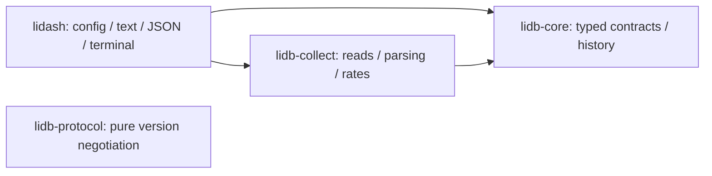

# Public Core architecture review

Reviewed the implemented Core candidate from PR #25 at `ec1d307fc9fcfa0da390829205407923a222eb4a`, plus scoped fixes on `agent/codex/agent-handoff` for issue #26. This is a source/dependency and regression review by the implementing coordinator, not an independent human approval or a guarantee that every defect is absent. Unimplemented networking, replay, eBPF and release phases were assessed as future boundaries, not tested features.

## Dependency and responsibility boundaries

Actual workspace metadata reports an acyclic dependency graph:

Core and protocol depend on neither OS collection nor presentation. Collection owns procfs reads, parsing, failure isolation and counter baselines; the application owns sampling lifecycle, terminal state and rendering. One replaceable mailbox bounds queued snapshots. The protocol crate is a pure compatibility library, not a running transport/security boundary.

## Verified findings and changes

| Finding | Evidence / consequence | Resolution |
| --- | --- | --- |
| Wrong ARM64 final-component no-follow flag | `read.rs` used `0x20000` for both targets; Linux arm64 defines `O_NOFOLLOW` as `0x8000`, while `0x20000` is `O_LARGEFILE`. Static-link preinspection concealed the wrong open-time defense in existing tests. | Use named architecture-specific flags and directly test the open boundary against a symlink without preinspection. Native ARM CI must run the regression. |
| Stale product registry inside pure Core | Public `capability::bootstrap_registry` had no consumer and returned hard-coded disabled Linux areas with an obsolete P0 reason. | Remove that bootstrap helper/test. Generic Capability/Registry APIs remain; live doctor derives source status from actual observations. |
| Architecture/implementation drift | The source table suggested packet/error/drop exports and broader PSI counters; the collector exports RX/TX bytes/rates and `some avg10`. ADR-007 suggested default Tokio/epoll; the baseline uses a standard thread. | Correct source claims and record [ADR-022](DECISIONS.md#adr-022--implemented-core-boundaries-and-abi-validation-2026-10-12). |
| Missing persistent Antigravity continuation scope | The existing native rule applied only by model decision to concurrent work; there was no ordered task/resume contract. | Add always-on startup guidance, shared skill discovery and the task/dependency/acceptance queue. No runtime behavior changes. |

The ABI was verified against Linux v6.18 primary sources: [arm64 fcntl.h](https://github.com/torvalds/linux/blob/v6.18/arch/arm64/include/uapi/asm/fcntl.h) and [generic fcntl.h](https://github.com/torvalds/linux/blob/v6.18/include/uapi/asm-generic/fcntl.h). Supported live targets remain Linux x86_64/aarch64; other targets report unsupported before collection. No new dependency, unsafe code, service or runtime network connection was added.

## Five-axis assessment

- **Linux accounting and sources:** CPU guest ticks avoid double-counting; idle/iowait, MemAvailable, 512-byte disk sectors and per-device rates remain documented. No layered-device host total is invented. Kernel fields/PSI and namespace visibility are checked per source.
- **Telemetry integrity:** Export preserves exact unsigned counters, finite values, units, source and collector-local time; unavailable states retain reasons. Histories reject changed metric/source/unit and regressed timestamps. Batch time is the start of sequential reads, not an atomic host-wide observation. Clock-domain identity is caller-controlled and must be addressed before replay/import.
- **Privacy and permissions:** Read-only metadata collection, fixed sanitized I/O reasons, validated bounded identifiers and explicit live/fixture labels. Files are bounded at 1 MiB, devices at 64 per source, snapshots at 2048. No process arguments/environments/payloads or listener. Final-component no-follow does not eliminate intermediate-directory races; fixtures must remain trusted/static.
- **Reliability and resource use:** Source/device bounds yield at most 538 observations; names fit Core's metadata bounds and parsed quantities satisfy Snapshot insertion. The latest-slot queue bounds backlog while paused. Refresh cancellation and terminal cleanup are exercised; a synchronous read and a join waiting for it have no hard deadline. Production CPU/RSS/latency were not measured by this task.
- **Product and extensibility:** Text/JSON/doctor/TUI share one snapshot; doctor means collection availability, not host health. Routes, endpoints and interface metadata need structured records and source-specific policies before presentation. The continuation queue supplies those boundaries without reinstating vendor/AI/cluster scope.

## Remaining engineering limits

| Priority | Limit | Next slice |
| --- | --- | --- |
| Before claiming hard shutdown deadlines | Synchronous reads can stall; Worker shutdown joins; byte limits are not time limits | AG-01: define/test lifecycle, outstanding-read bounds and cleanup |
| Before P2 structured network export | No typed route/endpoint/interface report or source-specific sysfs policy | AG-02 then AG-03/04/05 |
| Before persistence/replay or cross-collector correlation | No durable clock-domain identity or global multi-series retention/byte budget | AG-06 |
| Before public release/performance/support claims | Full dependency notices/SBOM, measured overhead and wider distribution/container matrix incomplete | AG-07 |

See the [Antigravity queue](../.AGENTS/ANTIGRAVITY.md) for ownership, dependencies and acceptance criteria. These limits are not waived or represented as completed. Optional privileged/eBPF/active diagnostics stay separately authorized.

## Compatibility and verification

Snapshot JSON 0.1 and protocol negotiation are unchanged. The removed helper was pre-stable and unconsumed inside the workspace; any external caller should use `CapabilityRegistry::new()` and register its own actually checked capabilities.

Exact commands, environment, results and PR/check links are recorded in [WORKLOG.md](../.AGENTS/WORKLOG.md) and the [issue #26 task note](../.AGENTS/worklogs/issue-26.md). Source/dependency review is distinct from live local/native CI evidence. The direct open regression exercises behavior rather than asserting a copied constant.
